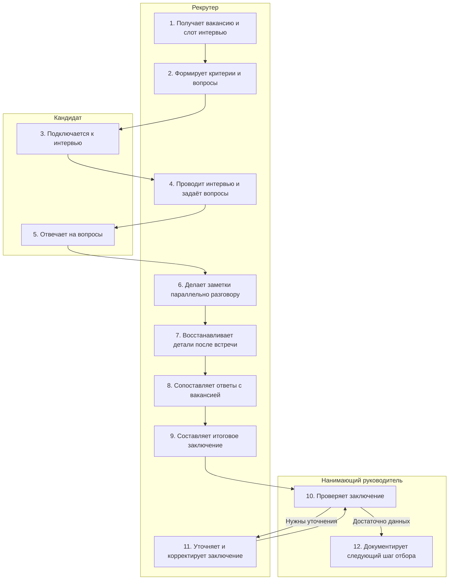

# Анализ процесса AS-IS

## Границы процесса

| Граница | Событие |
|---|---|
| Начало | Для назначенного кандидата и утверждённой вакансии рекрутер начинает подготовку к интервью |
| Конец | Проверенное заключение рекрутера передано нанимающему руководителю, который документирует решение о следующем шаге отбора |
| Вне процесса | Поиск и привлечение кандидатов, размещение вакансий, скрининг резюме до назначения интервью, оффер, онбординг, окончательное трудоустройство; общие совещания и режим помощи соискателю моделируются отдельно |

Единица наблюдения — одно интервью. В процессе **12 шагов**. Системы в таблице — классы инструментов, а не утверждение о наличии конкретного ATS или мессенджера у заказчика.

## Диаграмма процесса




На шаге 6 фиксация происходит **параллельно** вопросам и ответам; линейный порядок диаграммы упрощает изображение, но не означает, что кандидат сначала полностью закончил говорить, а рекрутер только затем начал записывать.

## Шаги процесса

| # | Шаг | Роль | Вход | Выход | Система | Время | Частота | Ожидание |
|---|---|---|---|---|---|---|---|---|
| 1 | Получает вакансию и слот интервью | Рекрутер | Вакансия, приглашение | Контекст интервью | ATS/почта/календарь, если применяются | - | На интервью | нет |
| 2 | Формирует критерии и вопросы | Рекрутер | Вакансия | План интервью | Документ/заметки | - | На интервью | нет |
| 3 | Подключается к интервью | Кандидат | Приглашение | Участие в созвоне | ВКС | - | На интервью | возможно |
| 4 | Проводит интервью и задаёт вопросы | Рекрутер | План, кандидат | Вопросы и контекст | ВКС | 1 час | На интервью | нет |
| 5 | Отвечает на вопросы | Кандидат | Вопросы | Устные ответы | ВКС | 1 час | На интервью | нет |
| 6 | Делает заметки параллельно разговору | Рекрутер | Устные ответы | Фрагментарные записи | Документ/заметки | 45 мин | На интервью, если заметки ведутся | нет |
| 7 | Восстанавливает детали после встречи | Рекрутер | Память, заметки | Уточнённые записи | Документ/заметки | 1 час | Если нужно восстановление | возможно |
| 8 | Сопоставляет ответы с вакансией | Рекрутер | Ответы, критерии | Оценка соответствия | Документ/таблица | Не измерено | 45 мин | нет |
| 9 | Составляет итоговое заключение | Рекрутер | Оценка, заметки | Сводка кандидата | Документ/ATS | Не измерено | 20 мин | нет |
| 10 | Проверяет заключение | Нанимающий руководитель | Сводка кандидата | Подтверждение или запрос уточнений | ATS/почта | 24 мин | На заключение | возможно |
| 11 | Уточняет и корректирует заключение | Рекрутер | Замечания руководителя | Исправленная сводка | Документ/ATS | до месяца | При запросе | возможно |
| 12 | Документирует следующий шаг отбора | Нанимающий руководитель | Проверенное заключение | Решение человека: следующий этап/дополнительная оценка/отказ | ATS/принятый канал | - | На рассмотрение | нет |

**Точка максимального предполагаемого напряжения:** шаги 4–6, где один сотрудник одновременно должен вести разговор, слушать, проверять ответы и фиксировать подробности. Второй риск возникает на шагах 8–10 при переносе заметок в кадровую оценку без возможности быстро проверить их по первоисточнику.


## Источники данных

| Что утверждаем | Источник | Тип | Как получен |
|---|---|---|---|
| Этапы и обязательные элементы моделирования AS-IS | https://github.com/hrtech2026/hrtech-practice/blob/main/docs/methodology.md | Документ | Публичная методика |
| Структура девяти колонок и Mermaid | https://github.com/hrtech2026/team-template/blob/main/docs/02_asis_analysis.md | Документ | Официальный шаблон |
| 12-шаговая последовательность типового интервью | Модель команды; внешнего подтверждения заказчика нет | Гипотеза | Проектное моделирование, требующее интервью с HR |
| Длительность шагов 1–12 | Наблюдение + беседа с сотрудниками ГПН | Планируемое наблюдение | Хронометраж минимум двух групп сопоставимых интервью |

## Обнаруженные проблемы

| # | Проблема | Тип | Влияние | Источник |
|---|---|---|---|---|
| P1 | При одновременном разговоре и конспектировании могут теряться важные факты | Невидимое знание / точка отказа | Неполное заключение и необоснованная интерпретация кандидата | Гипотеза; проверить сравнением аудио и заметок |
| P2 | Восстановление реплик по памяти после интервью дублирует часть работы | Дублирование / лишний шаг | Дополнительные минуты на заключение, вероятность искажений | Гипотеза; хронометраж шагов 6–9 |
| P3 | Руководитель не всегда может быстро проверить, из какой реплики сделан вывод | Ожидание / невидимое знание | Дополнительные уточнения и время согласования | Гипотеза; интервью с руководителем, анализ запросов |
| P4 | Субъективность заметок или некритичное копирование ИИ-оценки могут подменить факты выводами | Точка отказа | Риск необоснованного отказа, несправедливой оценки и потери ответственности HR | Риск-конфликт; проверить слепой экспертизой решений и наблюдением поведения HR |
| P5 | Использование несанкционированных онлайн-сервисов для сводок может привести к выводу данных кандидата из разрешённого контура | Точка отказа | Риск нарушения правил обработки персональных данных | Гипотеза риска; проверить ИБ-процедуры и инструменты |

**Возможные обходные пути (не подтверждены):** рекрутер составляет личные заметки вне ATS; вручную копирует информацию в несколько форм; просит кандидата повторить сказанное; переносит фрагменты интервью в внешний чат-бот. Каждый такой сценарий нужно подтвердить наблюдением. До этого нельзя писать, что сотрудники фактически обходят регламент.

**Почему одной инструкцией не решить:** если подтвердится конкуренция внимания при разговоре и записи, регламент «фиксировать всё точнее и быстрее» не создаст дополнительной рабочей памяти и времени. Но наличие именно этого ограничения в выбранной организации пока остаётся гипотезой.

## Оценка потерь

```text
Считать отдельно активные трудозатраты и календарное ожидание:

T_ASIS = T_подготовка + T_заметки_после + T_проверка + T_исправления
T_TOBE = T_подготовка_вакансии + T_проверка_ИИ + T_исправления_ИИ
Экономия HR-времени = (T_ASIS - T_TOBE) × число интервью
Календарное ожидание руководителя измеряется отдельно и не считается
оплаченной работой HR.

100 интервью/месяц; подготовка заключения AS-IS = 25 мин/интервью;
подготовка и проверка TO-BE = 15 мин/интервью.
Экономия = (25 - 15) × 100 / 60 = 16,67 часа в месяц.
При условной полной стоимости часа HR 800 ₽/ч:
16,67 × 800 ≈ 13 333 ₽ эквивалента высвобожденного времени.

Время разговора, зарплату за неотработанные часы и финансовую
экономию от сокращения штата в расчёт не включаем.
```

## Связь с этапом 1

| Проблема AS-IS | Противоречие из 01_problem.md |
|---|---|
| P1: возможные пропуски важных ответов | Скорость фиксации vs полнота и фактическая достоверность |
| P2: возможное повторное восстановление разговора | Снижение HR-трудозатрат vs сохранение качественной аналитики |
| P3: возможные уточнения из-за отсутствия ссылок | Скорость передачи заключения vs проверяемость каждого вывода |
| P4: субъективность и автоматическое доверие ИИ | Автоматизация vs справедливость и ответственность человека |
| P5: передача данных в несанкционированные сервисы | Качество внешней аналитики vs конфиденциальность |